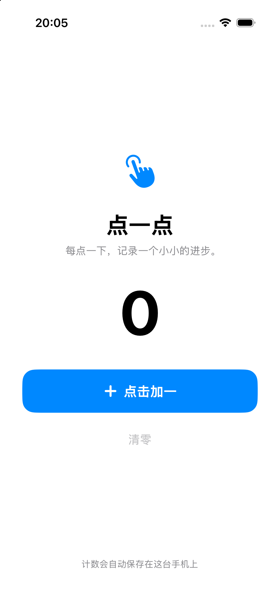

# TapCounter · 点一点

A minimal SwiftUI counter for iPhone. 一个简单、离线运行的 iPhone 计数器，用于验证 App 构建、签名与安装流程。

## 下载

从 [Releases](https://github.com/xutongqing/tapcounter-ios/releases) 下载 `TapCounter-unsigned.ipa`。

**此 IPA 未签名，不能直接安装到普通 iPhone。请使用自己的 Apple 开发者身份完成签名，并为目标设备配置有效的描述文件后安装。**

## 功能

- 点击按钮，计数加一。
- 一键清零。
- 自动保存计数，关闭后重新打开仍可继续。
- 无需登录，不使用网络服务。



## 技术信息

| 项目 | 内容 |
| --- | --- |
| 界面 | SwiftUI |
| 最低系统版本 | iOS 16.0 |
| 设备 | iPhone，arm64 真机架构 |
| 数据存储 | 本机 UserDefaults（@AppStorage） |
| Bundle ID | `com.example.tapcounter.demo` |
| 版本 | 1.0（Build 1） |

## 本地构建

需要安装包含 iOS SDK 的完整 Xcode，并让命令行开发工具指向该 Xcode。

打开 `TapCounter.xcodeproj` 可以查看或修改 App。生成未签名 IPA：

```bash
bash scripts/build_unsigned.sh
```

产物位于 `outputs/TapCounter-unsigned.ipa`。构建过程不需要 Apple 账号或签名证书；真机安装前仍需签名。

如需重新生成 App 图标：

```bash
python3 scripts/generate_icon.py
```

## 验证范围

已完成 iPhone arm64 Release 构建、IPA 结构检查，以及 iOS 模拟器启动和界面检查。发布包没有附带签名证书或设备描述文件，未在真实 iPhone 上完成签名安装测试。
